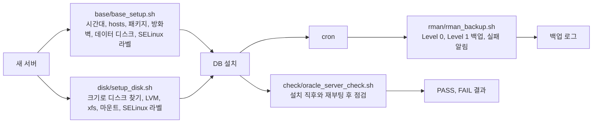

# linux-ops-scripts

DB 서버를 구축하고 운영하며 실제로 쓴 셸 스크립트(서버 점검, 디스크 준비, 기본 설정, 백업)를 용도별로 모은 저장소다.

## 구성도



## 한 일

| 스크립트 | 하는 일 | 쓴 곳 |
|---|---|---|
| `check/oracle_server_check.sh` | 디스크 마운트, THP, `hugetlb_shm_group`, `/etc/hosts`, Oracle 실행 파일, 서비스 자동 기동, 리스너의 PDB 등록, 인스턴스와 PDB 상태, ARCHIVELOG, ASMM, HugePages 사용, 리스너 포트, 방화벽을 PASS, FAIL로 판정한다 | [oracle19c-install](https://github.com/kangyoungsoo-db/oracle19c-install) |
| `disk/setup_disk.sh` | 장치 이름 대신 크기로 빈 디스크를 정확히 1개 찾아 VG, LV, xfs, 마운트, fstab, SELinux 라벨 복원까지 한다. 이미 되어 있으면 아무것도 바꾸지 않는다 | [oracle19c-install](https://github.com/kangyoungsoo-db/oracle19c-install) |
| `base/base_setup.sh` | 시간대, hosts, 기본 패키지, 방화벽(필요한 서비스만 허용), 데이터 디스크 포맷과 마운트, PGDATA용 SELinux 라벨 등록을 한다. 조건에 맞는 빈 디스크가 정확히 1개일 때만 포맷한다 | [postgresql-patroni-ha](https://github.com/kangyoungsoo-db/postgresql-patroni-ha) |
| `rman/rman_backup.sh` | 인자로 Level 0 또는 Level 1 압축 백업을 받고, 보관 기간이 지난 백업 삭제, 대조, 실패 판정, 오래된 로그 정리를 한다 | [oracle19c-backup-recovery](https://github.com/kangyoungsoo-db/oracle19c-backup-recovery) |
| `rman/crontab.txt` | 일요일 Level 0, 월요일부터 토요일 Level 1 | [oracle19c-backup-recovery](https://github.com/kangyoungsoo-db/oracle19c-backup-recovery) |

공통으로 지킨 규칙이 있다.

- 여러 번 실행해도 결과가 같게 만든다. 이미 된 일은 건너뛴다.
- 지우거나 포맷하기 전에 조건을 모두 확인하고, 조건이 하나라도 어긋나면 멈춘다.
- 결과를 사람이 한눈에 읽을 수 있게 PASS, FAIL이나 OK, FAILED 한 줄로 남긴다.
- 비밀번호는 스크립트에 넣지 않는다.

## 결과 숫자

| 항목 | 결과 |
|---|---|
| 점검 스크립트 | 수동 구축한 Oracle 19c 서버에서 재부팅 후 점검 17항목 모두 통과 |
| 백업 스크립트 | 4.7GB 데이터를 압축 백업으로 660MB |

## 겪은 문제와 해결

### 1. 디스크 장치 이름이 부팅마다 같다는 보장이 없었다
- 원인: `/dev/sdb` 같은 이름은 디스크를 붙인 순서나 컨트롤러에 따라 바뀔 수 있다.
- 해결: 디스크를 크기로 찾고, 같은 크기가 정확히 1개일 때만 진행하게 했다. 이미 다른 데이터가 있는 장치면 멈춘다.
- 이유: 잘못된 디스크를 포맷하면 되돌릴 수 없다. 조건을 좁게 두는 편이 안전하다.

### 2. 새 파일 시스템에서 systemd가 실행을 거부했다
- 원인: 새로 만든 xfs에는 SELinux 라벨이 없어(`unlabeled_t`) systemd가 그 아래 파일을 실행하지 못했다.
- 해결: 마운트 직후 `restorecon -R` 로 정책 기본 라벨을 복원하게 `setup_disk.sh` 에 넣었다. PGDATA처럼 기본 경로가 아닌 곳은 `semanage fcontext` 로 라벨을 등록한 뒤 복원한다.
- 이유: SELinux를 끄지 않고 운영 설정 그대로 서비스를 올리기 위해서다.

### 3. cron에서 돌린 백업이 환경 변수를 몰랐다
- 원인: cron은 로그인 셸의 `.bash_profile` 을 읽지 않는다.
- 해결: `ORACLE_HOME`, `ORACLE_SID`, `PATH` 를 스크립트 안에서 정했다.
- 이유: 손으로 돌릴 때와 cron이 돌릴 때 결과가 같아야 자동화라고 할 수 있다.

### 4. 백업이 실패해도 알기 어려웠다
- 원인: RMAN은 일부 단계가 실패해도 긴 로그만 남긴다.
- 해결: 로그에 `RMAN-` 나 `ORA-` 가 있으면 `BACKUP FAILED` 한 줄을 내고 종료 코드 1로 끝나게 했다.
- 이유: 한 줄 결과와 종료 코드가 있어야 메일이나 메신저 알림으로 바로 이어 붙일 수 있다.

## 따라 하는 법

점검 (root)

```bash
sudo bash check/oracle_server_check.sh
```

디스크 준비 (root, 마운트 이름과 디스크 크기 GB를 준다)

```bash
sudo bash disk/setup_disk.sh <이름> <GB>
```

기본 설정 (root, 스크립트 안의 IP와 디스크 크기를 먼저 맞춘다)

```bash
sudo bash base/base_setup.sh
```

백업 (oracle 계정)

```bash
bash rman/rman_backup.sh 0
```
```bash
bash rman/rman_backup.sh 1
```

cron 등록은 `rman/crontab.txt` 의 두 줄을 `crontab -e` 로 넣는다.
